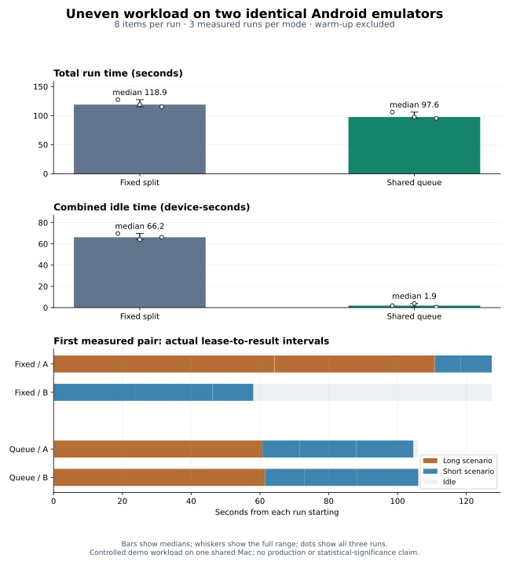

# Uneven-workload benchmark — 2026-11-05

The shared queue took **97.6s median**, compared with **118.9s** for fixed round-robin assignment: **17.9% less wall time** in this controlled sample. Both modes executed the same eight scenario items on the same two Android emulators. Three measured runs per mode are too few to establish statistical significance or a production-wide speedup.

## Method

Date is Korea Standard Time; raw API timestamps are UTC.

- Application commit: `d98a20d5c7782819639285d21e97050518e2c54f` (0.0.32). Only documentation changes followed the measurement.
- Host: Intel(R) Core(TM) i9-9880H CPU @ 2.30GHz; 16 GiB RAM; macOS 26.6.2; Node v22.20.0; pnpm 11.21.0.
- Two copies of `Medium_Phone_API_36.0`, Android 16 / API 36, emulator 36.1.9. Each used four virtual cores, 2048 MiB RAM, `-read-only -no-snapshot -no-window -no-metrics -no-audio -gpu swiftshader_indirect -feature -Vulkan`. They share one host; these are simulated devices.
- Appium 3.9.0 and UiAutomator2 8.7.3, one Appium server per emulator with distinct UiAutomator2 ports. Device names were `bench-a` and `bench-b`; `SESSION_MODE=reuse`, `LEASE_SECONDS=120`, no test accounts.
- Public [ApiDemos 6.0.18 debug APK](https://github.com/appium/android-apidemos/releases/tag/v6.0.18), SHA-256 `a9eecf37b26cd084855c530db81c2bb1b91f4c1b095a04f47aa7c20e2791f686`. Isolated PostgreSQL 17 database and a local server/runner.
- Scenario checkout `7ffea3cd9f4c88fb8ed59fb62ad9e57d2c1b3af2`: `a.long` navigates to the Controls text field and performs 24 text-entry/readback cycles; `b.short` does one cycle; `c.short` toggles a checkbox and checks it; `d.short` opens and accepts an alert. All interactions wait for UI state. No scenario uses a fixed sleep or a device-specific delay.
- Catalog order is `a.long`, `b.short`, `c.short`, `d.short`; repeat is 2, giving eight items. Current fixed round-robin assignment gives A both long items and two short items; B receives four short items. The queue can distribute both long items across the devices. Passing durations from warm-ups (including passing items of the failed setup runs) inform queue ordering; both splits use the same accumulated database history.
- One successful queue warm-up with the full workload was excluded. The six measured runs were fixed/queue, queue/fixed, fixed/queue. Both emulators and one runner stayed alive throughout; run changes still recreate Appium sessions, so session creation, app installation/reset and startup are included.
- Primary time is the server’s `durationMs`, from run creation to saving the final result. Busy time is lease-to-result, including session/app setup. Per-device idle time is run time minus that device’s busy time. Combined idle time sums the two devices, so its unit is device-seconds. Final teardown after the saved result is outside this duration.

## All measured runs

| Order | Run | Mode  | Duration (s) | A / B attempts | A / B long items | Combined idle (device-s) |
| ----- | --- | ----- | -----------: | -------------- | ---------------- | -----------------------: |
| 1     | 4   | fixed |       127.40 | 4 / 4          | 2 / 0            |                    69.66 |
| 2     | 5   | queue |       106.06 | 4 / 4          | 1 / 1            |                     1.86 |
| 3     | 6   | queue |        97.64 | 4 / 4          | 1 / 1            |                     3.90 |
| 4     | 7   | fixed |       118.95 | 4 / 4          | 2 / 0            |                    64.11 |
| 5     | 8   | fixed |       115.20 | 4 / 4          | 2 / 0            |                    66.20 |
| 6     | 9   | queue |        95.31 | 4 / 4          | 1 / 1            |                     0.44 |

Every measured run passed all eight items on attempt one. No measured run or outlier was discarded.

| Metric                   | Fixed median [min, max] | Queue median [min, max] |
| ------------------------ | ----------------------: | ----------------------: |
| Run time (s)             | 118.95 [115.20, 127.40] |   97.64 [95.31, 106.06] |
| Combined idle (device-s) |    66.20 [64.11, 69.66] |       1.86 [0.44, 3.90] |

Paired wall-time reductions, `(fixed − queue) / fixed`: pair 1: 16.7%, pair 2: 17.9%, pair 3: 17.3%.

## Interpretation and limits

This deliberately skewed workload illustrates the scheduling mechanism. The fixed baseline is this project’s existing round-robin split; a duration-aware static split may behave differently. The long item repeats real UI operations to create a predictable imbalance and does not represent a production test suite. The chart’s timeline uses the first measured pair, not a selected best result.

The shared host, software rendering, thermal state, caching and Appium/session startup introduce noise. Alternating order and showing every sample reduce hidden selection but do not remove those factors. The three-run medians and ranges are descriptive; no confidence interval, p-value or general hardware claim is made.

Setup evidence: warm-up runs 1 (two cores) and 2 (four cores) hit repeated System UI ANRs with Vulkan enabled and were cancelled before measurement. Their failed/cancelled attempts remain in the raw data. The final setup used four cores with SwiftShader GLES and Vulkan disabled, a [documented compatibility option](https://developer.android.com/studio/run/emulator-troubleshooting). No timings from failed setup runs are pooled into the measured comparison.

## Reproduce

The [raw measurements](2026-11-05-uneven-workload.json) include all run summaries, attempts, timelines, both failed setup warm-ups, environment metadata and exact workload source files under `metadata.workloadSources`. Local app-build paths are normalized to the APK filename, and local filesystem prefixes in error stacks use placeholders; measurement numbers are unchanged.

1. Build/run application commit above and use an isolated empty database. Start two identical emulators and separate Appium instances with the settings above; register only `bench-a` and `bench-b`.
2. Write each `metadata.workloadSources` entry to an external scenario folder, initialize/commit it as a Git checkout, and point the runner’s `SCENARIOS_DIR` there. Use `SESSION_MODE=reuse` and the same APK digest.
3. Create one successful warm-up queue run, then six runs in the recorded order. Send the same scenario commit, APK, platform `android` and `repeat: 2`; change only `split` between `fixed` and `queue`.
4. Wait for completion and collect `GET /runs/:id`, `/dashboard/api/runs/:id` and `/dashboard/api/runs/:id/attempts` for every run. Require eight passing first attempts; retain and disclose failures. Do not use CLI polling elapsed time as the run duration.
5. Recompute medians/ranges and the reduction formula above. Hardware/load differences may change the outcome.
